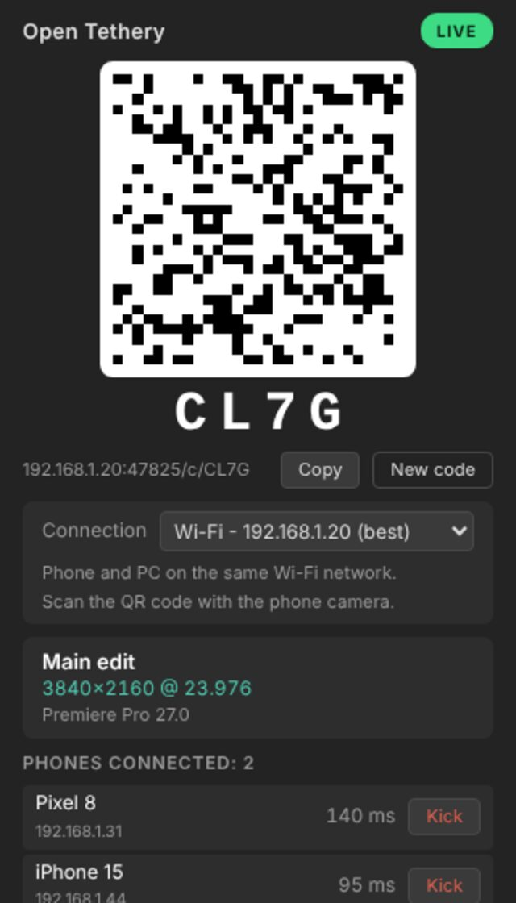
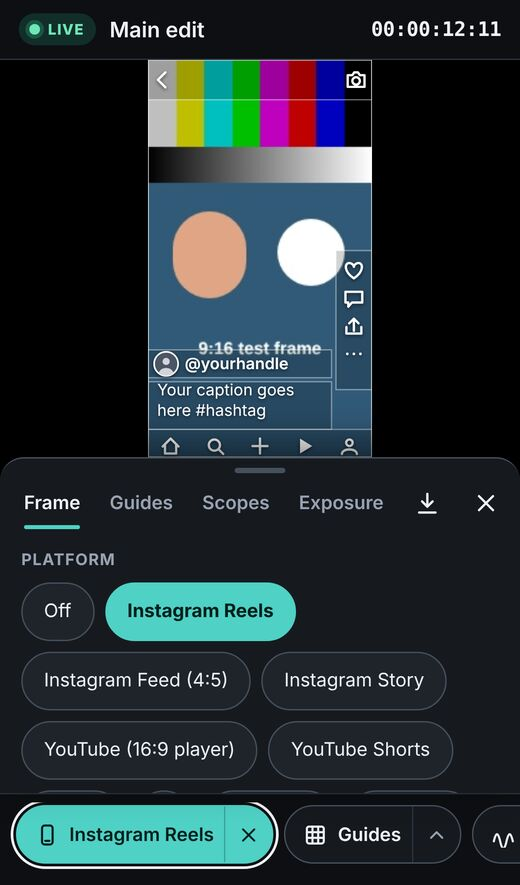
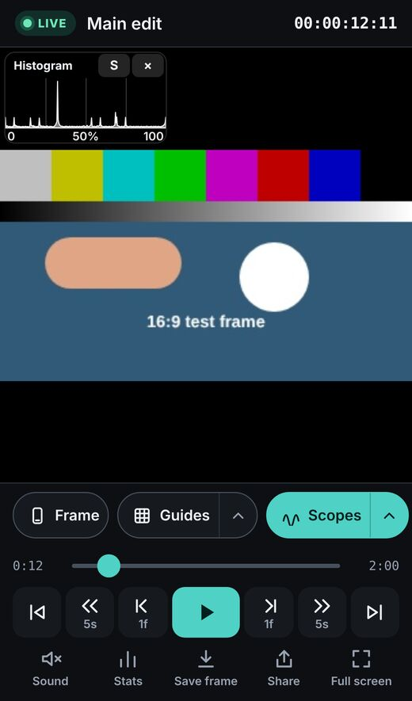
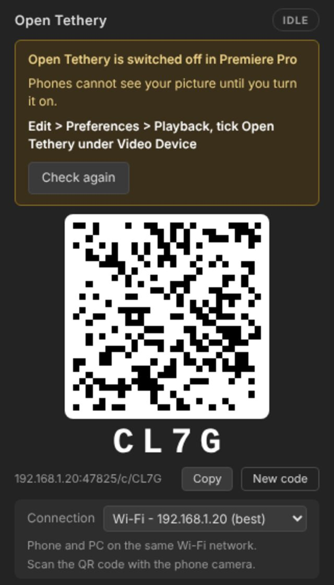

<div align="center">

# Open Tethery

**See your Premiere Pro, After Effects or Photoshop edit live on your phone.**
Scan a QR code, press play, and the phone plays the Program Monitor in real time, with sound,
social-app frames, scopes and playback controls. Nothing to install on the phone.



&nbsp;&nbsp;

&nbsp;&nbsp;


[What it does](#what-it-does) · [Install](#install) · [Use it](#use-it) · [Troubleshooting](#troubleshooting) · [How it works](#how-it-works) · [Developers](#for-developers)

</div>

---

## What it does

Most video is watched on a phone. Most video is edited on a big monitor. Open Tethery turns any phone,
tablet or laptop on your network into a second Program Monitor, so you can check framing, captions and
colour on the screen your audience will actually use, without exporting anything.

| | |
|---|---|
| **Live playback** | Every frame Premiere or After Effects draws: grades, titles, trims, multicam, scrubbing. |
| **Sound** | Timeline audio on the phone speaker, in sync (Premiere only; Adobe sends no audio from After Effects). |
| **Social frames** | Instagram Reels / Feed / Story, YouTube and Shorts, TikTok, X, Facebook, Snapchat, Pinterest, Reddit. Add your own @handle and avatar. Unsafe areas can glow red. |
| **Scopes and exposure** | Histogram (luma, RGB, parade), waveform, vectorscope, audio meters, false colour, zebras. |
| **Guides** | Title/action safe, thirds, centre mark, custom grid, letterbox mattes (2.39, 1.85, 4:5, 9:16 ...). |
| **Control from the phone** | Play, pause, step one frame, jump 5 s, scrub. You decide in the panel whether phones may control playback. |
| **Several phones at once** | Everyone follows the same playhead. Kick a phone or end the session from the panel. |
| **Save and share** | Save the current frame (clean or with overlays) or share it with the phone's share sheet. |
| **Private** | Frames go straight from your PC to the phone over your own network. No account, no cloud server. |

## Compatibility

| App | Version | How it appears | Live playback | Sound |
|---|---|---|---|---|
| Premiere Pro | 2024 or newer | Window › Extensions › **Open Tethery** | Yes | Yes |
| After Effects | 2024 or newer | Window › Extensions › **Open Tethery** | Yes | No (Adobe limit) |
| Photoshop | 2023 (24.0) or newer | Plugins › **Open Tethery** | Live canvas | n/a |

- **Computer:** Windows 10 or 11, 64-bit. macOS is planned.
- **Phone / tablet:** any modern browser. Tested with iPhone Safari and Android Chrome.
- **Network:** phone and PC on the same Wi-Fi or Ethernet network, or a phone hotspot, USB cable or Tailscale.

> **Beta.** Live picture on a real phone is confirmed. H.264 video, sound and the one-click installer are
> built and tested automatically but still being checked on real PCs. See [Project status](#project-status).

## Install

### Option A: installer (recommended, coming with the first release)

1. Download `OpenTetherySetup.exe` from the [Releases](../../releases) page.
2. Close Premiere Pro, After Effects and Photoshop.
3. Double-click the installer and click **Yes** when Windows asks for permission.

That's it. The installer adds the panel, the Premiere/After Effects plug-in, the Photoshop plug-in, the
background helper, a firewall rule for your private network, and an **Uninstall Open Tethery** entry.

### Option B: install from this repository (works today)

You need [Node.js 22](https://nodejs.org/) and, to build the Premiere/After Effects plug-in yourself,
Visual Studio 2022 with "Desktop development with C++" and the Adobe Premiere Pro C++ SDK
(see [Building the native plug-in](#building-the-native-plug-in)).

Open **PowerShell** in the repository folder and run:

```powershell
# 1. Build the background helper (once, and again after updates)
powershell -ExecutionPolicy Bypass -File installer\build-helper-exe.ps1

# 2. See what will be installed, without changing anything
powershell -ExecutionPolicy Bypass -File installer\dev-install.ps1 -WhatIf

# 3. Install (one Windows admin prompt)
powershell -ExecutionPolicy Bypass -File installer\dev-install.ps1
```

Useful options: `-SkipNative` (no Premiere/AE plug-in), `-SkipPhotoshop`, `-NoStart`.
Full details: [installer/README.md](installer/README.md).

### One-time switch in Premiere and After Effects

Adobe only sends video to plug-ins you switch on. Do this once per app, after installing:

| App | Where | What to tick |
|---|---|---|
| Premiere Pro | Edit › Preferences › **Playback** › Video Device | **Open Tethery** |
| After Effects | Edit › Preferences › **Video Preview** | **Open Tethery** |

The panel checks this for you. If it's off, the panel says so and shows these exact clicks.



### Uninstall

Use **Settings › Apps › Open Tethery › Uninstall**, or for a repository install:

```powershell
powershell -ExecutionPolicy Bypass -File installer\dev-uninstall.ps1
```

## Use it

1. **Open the panel.** Premiere / After Effects: **Window › Extensions › Open Tethery**. Photoshop: **Plugins › Open Tethery**.
2. **Scan the QR code** with your phone's camera. Or open the address under the QR and type the
   **four-letter code** (for example `CL7G`).
3. **Press play** in Premiere. The phone plays along. Tap **Sound** on the phone to hear the timeline
   (phones only play sound after a tap).

On the phone, tap the picture to show the controls:

| Control | What it does |
|---|---|
| ⏮ ⏪5s ◀1f ▶ 1f▶ 5s⏩ ⏭ and the scrub bar | Control playback (if **Allow control from phones** is on in the panel) |
| **Frame** chip | Pick a social platform frame; set your profile in its settings |
| **Guides** chip | Safe areas, thirds, grid, letterbox |
| **Scopes** chip | Histogram, waveform, vectorscope, audio meters. Drag to move; S / M / L to resize |
| **Exposure** | False colour and zebras |
| **Sound · Stats · Save frame · Share · Full screen** | Bottom row |

Tip: on iPhone use **Share › Add to Home Screen** and the viewer opens full screen like an app.

## Troubleshooting

<details>
<summary><b>The phone can't open the page</b></summary>

- Make sure the phone and PC are on the **same network**. Guest Wi-Fi and many office networks block
  devices from seeing each other. Use a phone hotspot or USB cable instead (pick it in the panel's
  **Connection** menu, the QR updates).
- Windows Firewall must allow **TCP port 47825** on **Private** networks. The installer adds the rule
  "Open Tethery Helper". If your Wi-Fi is set to *Public* in Windows, switch it to *Private*.
- VPN on the PC or phone? Turn it off or use the **Tailscale** option in the Connection menu.
</details>

<details>
<summary><b>The panel says "Helper not running"</b></summary>

The helper is the small background program that serves the phone. It starts with Windows, and the
Premiere/After Effects panel starts it if it isn't running. Otherwise sign out and back in to Windows. Check it at
`http://127.0.0.1:47825/health` in a browser on the PC.
</details>

<details>
<summary><b>The phone connects but shows "waiting for picture"</b></summary>

- Premiere / AE: switch on **Open Tethery** in Preferences (see [One-time switch](#one-time-switch-in-premiere-and-after-effects)) and restart the app.
- Play or scrub the timeline once. A picture is sent when the Program Monitor draws a frame.
- Photoshop: open a document.
</details>

<details>
<summary><b>"Open Tethery" is missing from Window › Extensions</b></summary>

Restart the Adobe app after installing. For a repository install, unsigned panels need Adobe's debug flag;
`dev-install.ps1` sets it for you (`PlayerDebugMode` under `HKCU\Software\Adobe\CSXS.9` to `CSXS.13`).
</details>

<details>
<summary><b>No sound</b></summary>

Tap **Sound** on the phone (browsers need a tap first) and check the phone isn't on silent.
After Effects does not send audio to plug-ins, so there is no sound from AE.
</details>

<details>
<summary><b>"Wrong code" or "locked"</b></summary>

After 5 wrong codes a phone is locked out for one minute. Press **New code** in the panel and scan again.
</details>

<details>
<summary><b>Still stuck? Send a report</b></summary>

In the panel press **Send report**. It saves a zip with logs and network details on your PC
(nothing is uploaded) and opens the folder, so you can attach it to an issue.
</details>

## How it works

```
 Premiere Pro / After Effects               Photoshop
 ┌───────────────────────────┐              ┌─────────────────────┐
 │ Panel (CEP)               │              │ Panel (UXP)         │
 │ QR, code, phones, control │              │ sends canvas pixels │
 │ Transmit plug-in (C++)    │              └──────────┬──────────┘
 │ Program Monitor frames,   │                         │
 │ timeline audio, H.264     │                         │
 └─────────────┬─────────────┘                         │
               │ localhost                             │ localhost
               ▼                                       ▼
        ┌──────────────────────────────────────────────────┐
        │ Helper (background app, starts with Windows)     │
        │ codes and lockout · WebRTC to phones · JPEG      │
        │ fallback · serves the phone page on port 47825   │
        └───────────────────────┬──────────────────────────┘
                                │ your Wi-Fi / hotspot / USB / Tailscale
                                ▼
              Phone browser: picture, sound, overlays, scopes, controls
```

- Pictures come from Adobe's **Mercury Transmit** interface, the same one used for external monitors,
  so it never changes your sequence or exports anything.
- The plug-in only copies frames out and encodes them with Windows' built-in GPU encoder on its own thread.
  It drops frames rather than slow Premiere down.
- Overlays and scopes are drawn on the phone, so your PC does no extra work.

Wire formats: [docs/PROTOCOL.md](docs/PROTOCOL.md) (helper ↔ panels ↔ phones) and
[docs/transmit-protocol.md](docs/transmit-protocol.md) (plug-in ↔ helper). Full plan: [docs/PRODUCT-PLAN.md](docs/PRODUCT-PLAN.md).

## Project status

| Milestone | Status |
|---|---|
| Panel + QR, one helper for all apps | ✅ working on a real PC |
| Premiere playback on the phone (JPEG) | ✅ working on a real PC |
| H.264 over WebRTC, sound, phone controls, pairing code, connections | 🧪 built and tested automatically, real-PC check in progress |
| Social frames, guides, scopes, exposure, save frame | 🧪 built and tested in a phone-size browser |
| One-click installer (`OpenTetherySetup.exe`) | 🛠 script written, first build pending |
| macOS, viewing over the internet | 🔜 later |

## For developers

### Repository layout

| Folder | What it is |
|---|---|
| [`helper/`](helper/) | Node 22 background app: sessions, QR, phone page, WebRTC, plug-in input |
| [`viewer/`](viewer/) | Phone web app (no build step): picture, sound, controls, overlays, scopes |
| [`panels/cep/`](panels/cep/) | Premiere Pro + After Effects panel |
| [`panels/uxp-photoshop/`](panels/uxp-photoshop/) | Photoshop plug-in |
| [`native/transmit/`](native/transmit/) | C++ Mercury Transmit plug-in (video, audio, H.264) |
| [`installer/`](installer/) | Dev install/uninstall scripts, helper .exe build, Inno Setup script |
| [`e2e/`](e2e/) | End-to-end tests: real helper, fake Premiere, simulated iPhone |
| `apps/` | Older prototypes, kept for reference until the new code is fully PC-tested |
| `sdk/` | **Not committed.** The Adobe Premiere Pro C++ SDK goes here locally |

### Try it without any Adobe app

```bash
npm run install:all      # npm install in every component
npm run test:all         # all unit tests + the end-to-end test

cd helper
OT_VIEWER_DIR=../viewer node bin/open-tethery-helper.js   # prints the session code
node tools/fake-transmit.js                               # second terminal: fake Premiere frames
```

Open `http://127.0.0.1:47825/c/<code>` in a browser, or on a phone via your PC's LAN address.

### Building the native plug-in

The Premiere Pro C++ SDK is licensed by Adobe and is never committed. Unzip it so this path exists:

```
sdk/Premiere Pro 27.0 C++ SDK/Examples/Headers
```

or set `PREMIERE_SDK` to the SDK's `Examples` folder. Then build with Visual Studio 2022:

```bat
MSBuild native\transmit\OpenTetheryTransmit.vcxproj /p:Configuration=Release /p:Platform=x64
```

Output: `build\native\Release\OpenTetheryTransmit.prm`. Details and the PC test checklist:
[native/transmit/README.md](native/transmit/README.md).

### Contributing

Issues and pull requests are welcome. Each folder's README has a **Needs PC test** list; those are the
most useful things to try on a real machine.

---

<sub>Open Tethery is an independent project, not affiliated with or endorsed by Adobe. Premiere Pro,
After Effects and Photoshop are trademarks of Adobe. Social platform frames are original outline drawings,
not those apps' artwork.</sub>
